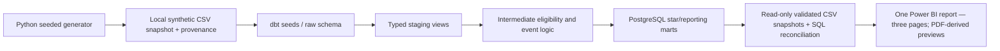
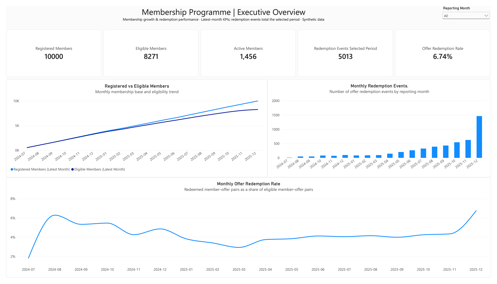
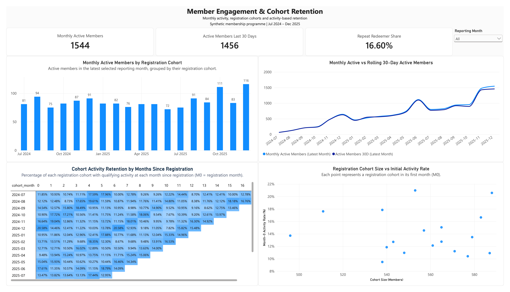
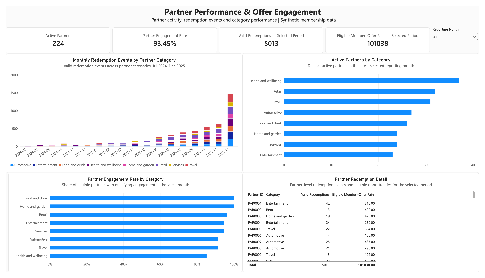

# Membership Metrics Lab — Governed Analytics Engineering

**G4 presentation decision:** the owner accepts the supplied Power BI report and PDF **as-is**; no further visual changes are requested. The report is one artifact with three pages. Refresh, Reopen, filter interactions, relationship behavior and accessibility were not supported by Desktop evidence and remain **NOT VERIFIED**—they are not represented as PASS. The gallery below contains direct PNG raster previews of the supplied PDF pages, not Windows Desktop screenshots. This is a fictional synthetic case study—not a Blue Light Card product, engagement, deployment or representation of its internal systems. No real business outcomes or paid professional experience are claimed.

## Business purpose

Demonstrate a traceable route from ambiguous membership questions to governed KPIs, deterministic source data, tested SQL/dbt models and BI reporting. The fictional domain is “MemberLoop.” The scope answers five questions about registered/eligible members, engagement, offer redemptions, partner categories and cohort retention.

## Intended users and decisions

The intended users are **fictional** membership operations, marketing, partnerships and analytics personas. The report is designed to help them inspect member activity, redemption behavior, partner/category participation and cohort retention, and to identify where data quality or incomplete follow-up limits interpretation. These are proposed decision-support use cases—not observed users, interviews, recommendations for a real operator or measured business outcomes.

## Architecture



**Verified local stack:** Python 3.12.13, uv lockfile, PostgreSQL 18.6 on ARM64 Docker, dbt Core 1.12.6, dbt-postgres 1.11.0, pytest 9.2.0 and Ruff 0.17.3. PostgreSQL is bound only to `127.0.0.1:54329`; the database password lives in ignored local `.env`. No hosted service, paid resource or public endpoint is used.

See [`docs/architecture/dbt-model-plan.md`](docs/architecture/dbt-model-plan.md), [`docs/architecture/dbt-lineage.md`](docs/architecture/dbt-lineage.md), [`docs/architecture/powerbi-implementation.md`](docs/architecture/powerbi-implementation.md), and [`docs/architecture/powerbi-authoring-spec.md`](docs/architecture/powerbi-authoring-spec.md).

## Synthetic data disclosure

All data is generated and pseudonymous. No real member records, personal data, scraped information, Blue Light Card data or employer systems are used. The default deterministic snapshot covers 2024-07-01 through 2025-12-31 inclusive and contains 10,000 members, 250 partners, 1,000 offers, 50,000 offer-eligibility pairs, 5,013 redemption events and 14,506 member activity events. The seed, interval and per-file counts are recorded in ignored local `provenance.json` and `simulation_period.csv`.

These are test-design volumes and generated outcomes, not estimates of any real platform's behaviour, revenue, customer value or savings.

## Governed model

- **Raw seeds:** nine generated CSVs (eight source tables plus the one-row simulation control), loaded under `raw`.
- **Staging:** explicit typed source views.
- **Intermediate:** validated redemption classification, qualifying member events and distinct member-offer opportunity periods.
- **Marts:** member/partner/offer/date dimensions, a valid-redemption event fact, member-month engagement, partner-month performance, cohort retention and a monthly executive KPI panel.
- **Grain protection:** offer redemption rates use distinct member-offer pairs; partner rates count a partner once; snapshot metrics are kept separate from monthly flows.
- **Time:** UTC event dates and start-inclusive/end-exclusive intervals. Incomplete calendar months are identified and excluded from complete-period cohort comparisons. Zero denominators yield NULL.

Ten KPI definitions, fictional ownership, change history and limitations are documented in [`docs/governance/kpi-dictionary.md`](docs/governance/kpi-dictionary.md). See the P3 source reconciliation tests and `dbt/models/_models.yml` for executable checks and model/column descriptions. Cohort retention assigns each member to the UTC registration month and compares relative calendar month `k`; the denominator remains the original eligible cohort size, so rates are non-additive. Activity is only a proxy for retention.

## Quality evidence

- `pytest`: **13 passed** (generator, provenance, validation and controlled negative cases).
- Ruff lint and format checks: passed.
- Generator: two full default runs produced **10 byte-identical artifacts**; both validators reported **0 issues**. Combined local generation time: **6.284 s** (one measurement, not a service-level or scale claim).
- `dbt debug`: passed against the local PostgreSQL 18.6 service.
- `dbt compile`: passed; `dbt docs generate`: completed.
- Two full `dbt build` runs: each **21 models, 9 seeds, 120 data tests and 1 unit test passed**; all nine mart tables had identical row counts and fingerprints across the two builds. Local full-build times were **26.92 s** and **26.89 s**; these are single-host observations, not performance promises.
- One dbt unit test covers both partial-start and partial-end months. A direct source reconciliation test caught and drove correction of a rolling-30-day month-boundary defect.
- GitHub Actions workflow is prepared but has **not** run on GitHub; do not interpret local checks as a remote CI result.

Exact evidence is in [`docs/evidence/G2-checkpoint.md`](docs/evidence/G2-checkpoint.md) and [`docs/evidence/G3-checkpoint.md`](docs/evidence/G3-checkpoint.md). Generated datasets, database files and dbt `target/` artifacts are not committed.

## Reproduce locally

Prerequisites: macOS/Apple Silicon or another compatible local host, Python 3.12, uv, Docker Desktop with the `docker-compose` CLI and OpenSSL. The project uses `docker-compose`; this host does not expose the `docker compose` plugin command.

```bash
uv sync --locked
uv run --locked membership-metrics-generate
uv run --locked membership-metrics-validate
uv run --locked pytest
uv run --locked ruff check src tests
uv run --locked ruff format --check src tests
```

Start a local database with a random project-local password. This creates an ignored `.env`; it does not print the generated password:

```bash
(umask 077; printf 'MML_DB_PASSWORD=%s\n' "$(openssl rand -hex 32)" > .env)
docker-compose -f compose.yaml up -d --wait warehouse
set -a; . ./.env; set +a
uv run --locked dbt debug --project-dir dbt --profiles-dir dbt/profiles
uv run --locked dbt build --project-dir dbt --profiles-dir dbt/profiles
uv run --locked dbt docs generate --project-dir dbt --profiles-dir dbt/profiles
```

The generator refuses to overwrite a non-empty output folder. To generate another snapshot, provide a new `--output` directory and update `seed-paths` in `dbt/dbt_project.yml` deliberately before loading it. Keep `.env` local; `.env.example` contains only a placeholder. `dbt/target/` contains generated catalog/lineage artifacts and is ignored by Git.

## Current analytical output and limitations

The verified default run creates 18 monthly rows. In the synthetic December 2025 baseline, SQL reports 10,000 registered members, 8,271 eligible members, 1,456 active in the inclusive 30-day window, 1,544 monthly active members, 1,462 valid redemption events, 19,667 eligible member-offer pairs and a 6.74% offer-redemption rate. The supplied PDF shows a 5,013 selected-period redemption-event total, a 16.60% repeat-redemption rate, a 93.45% partner-engagement rate and 101,038 selected-period member-offer-month opportunities. That 101,038 is an aggregation across partner-month opportunities, not a globally distinct multi-month pair count. These are reproducible outcomes of this synthetic scenario, not business benchmarks or evidence about Blue Light Card.

No real offer impressions, campaign targeting, financial settlement, revenue, causal effects or stakeholder interviews are modeled. The data generator encodes artificial event frequencies and seasonality. The high partner engagement rate therefore warrants investigation in a real scenario; it is not a recommendation to real operators.

## Project documentation

- [`docs/business/business-case.md`](docs/business/business-case.md), [`docs/business/requirements.md`](docs/business/requirements.md) and [`docs/business/stakeholder-personas.md`](docs/business/stakeholder-personas.md) describe the fictional problem, scope and hypothetical users.
- [`docs/data/synthetic-data-contract.md`](docs/data/synthetic-data-contract.md) defines schema, grain, deterministic provenance and deliberate omissions.
- [`docs/governance/kpi-dictionary.md`](docs/governance/kpi-dictionary.md) records the ten metric contracts; [`docs/governance/decision-log.md`](docs/governance/decision-log.md) tracks semantics and decisions.
- [`docs/architecture/dbt-lineage.md`](docs/architecture/dbt-lineage.md), [`docs/architecture/dbt-model-plan.md`](docs/architecture/dbt-model-plan.md), [`docs/architecture/powerbi-implementation.md`](docs/architecture/powerbi-implementation.md) and [`docs/architecture/powerbi-authoring-spec.md`](docs/architecture/powerbi-authoring-spec.md) explain transformation lineage and BI semantics.
- [`docs/evidence/G2-checkpoint.md`](docs/evidence/G2-checkpoint.md), [`docs/evidence/G3-checkpoint.md`](docs/evidence/G3-checkpoint.md) and [`docs/evidence/powerbi-acceptance-matrix.md`](docs/evidence/powerbi-acceptance-matrix.md) distinguish verified pipeline/source evidence from unverified Desktop behavior.

## Power BI report and page gallery

The supplied report has three pages. The gallery images are direct 240-DPI rasterizations of the corresponding pages in the owner-supplied PDF export. They preserve the PDF presentation; they are **not** screenshots captured from Windows Desktop and do not validate report interactivity.

### Executive Overview



Latest-month snapshot measures sit alongside selected-period flows. December 2025 values include 10,000 registered members, 8,271 eligible members, 1,456 active in the inclusive 30-day window and 1,462 valid redemption events.

### Member Engagement



The page combines monthly activity, 30-day activity, repeat redemption and cohort retention. The PDF displays only the visible portion of scrollable tables, including the cohort matrix; it is not complete 18-cohort matrix evidence. The snapshot has no incomplete/censored-period example.

### Partner Performance



The page reports partner/category/month results. The partner mart has no `offer_id`, so offer-level rankings are unsupported. The owner accepts the existing opportunity wording, numeric formatting and visible Matrix coverage as-is; these limitations are documented, not silently corrected.

### Evidence and scope

- Source mart snapshots contain **97,616 rows**; the stored SQL reconciliation reports **351/351 matches and zero failures**. The gallery does not independently rerun SQL or DAX.
- Visible PDF results include a 16.60% repeat-redemption rate and 93.45% partner-engagement rate for the stated synthetic reporting period. KPI definitions and grain are in [`docs/governance/kpi-dictionary.md`](docs/governance/kpi-dictionary.md); artifact/reconciliation evidence is in [`docs/evidence/powerbi-acceptance-matrix.md`](docs/evidence/powerbi-acceptance-matrix.md).
- Refresh, Reopen, relationship behavior, filter interactions and accessibility remain **NOT VERIFIED**. No test is marked PASS without supporting Windows Desktop evidence.
- No PBIX is included in the source tree. See reproducibility instructions above; a PBIX distribution decision remains separate from the PDF-derived gallery.

## Skills demonstrated

**BI Analyst:** governed KPI definitions, metric-to-decision mapping, semantic-model/report specification, cohort-retention interpretation, source-to-report reconciliation, and clear evidence boundaries for report behavior and accessibility.

**Data Analyst:** analytical SQL, Python data validation, PostgreSQL exploration, dbt transformation/testing, grain and temporal reasoning, quality checks, lineage, and reproducible synthetic-data analysis.

Desktop interactions and accessibility are explicitly outside the verified evidence in this release candidate.

**Licensing:** no license has been selected or granted yet. Source-code and synthetic-data terms must be decided separately before public publication.


