# Membership Metrics Lab

**Analytics Engineering · Business Intelligence · Membership Analytics**

Membership Metrics Lab is an end-to-end portfolio case study built around *MemberLoop*, a fictional membership platform. It explores how a membership team could define and monitor member eligibility, engagement, offer redemptions, partner participation and cohort retention using a reproducible synthetic data pipeline.

**Technology:** Python 3.12 · PostgreSQL 18.6 · dbt Core 1.12.6 · Power BI · Docker · uv · pytest · Ruff

[](https://github.com/vlad12-k/membership-metrics-lab/actions/workflows/ci.yml)

## Business problem

Membership organisations need a consistent way to distinguish registration and eligibility from recent activity, measure redemption opportunities without inflating counts, and understand partner engagement and retention over time. This project translates those questions into documented metric definitions, explicit data grain, tested transformations and a three-page Power BI report. The scenario and all results are fictional; they are not estimates or claims about any real business.

## Selected analytical results

The synthetic December 2025 baseline reports:

| Metric | Result |
|---|---:|
| Registered members | 10,000 |
| Eligible members | 8,271 |
| Eligible member-offer pairs | 19,667 |
| Monthly active members | 1,544 |
| Active members in the inclusive 30-day window | 1,456 |
| Valid December redemption events | 1,462 |
| Offer redemption rate | 6.74% |

The verified default run produces 18 monthly rows.

Across the synthetic reporting period, the source data contains **5,013 redemption events**. The supplied report shows a **16.60% repeat-redemption rate**, **93.45% partner-engagement rate**, and **101,038 selected-period member-offer-month opportunities**. The latter is an aggregation across partner-month opportunities, not a globally distinct multi-month pair count. These are outputs of this generated scenario, not business benchmarks or observed commercial outcomes.

## Power BI report

The report presents one view across three complementary pages. The images below are static 240-DPI rasterizations of the corresponding pages in the report's PDF export.

### Executive Overview


Summarises registered and eligible members, recent activity, redemption activity and monthly trends.

### Member Engagement & Cohort Retention


Explores member activity patterns, repeat redemptions and retention by registration cohort.

### Partner Performance & Offer Engagement


Compares partner/category/month results. The partner mart does not contain `offer_id`, so offer-level partner rankings are not supported.

## Technology and data architecture

```mermaid
flowchart LR
  GEN[Python deterministic generator] --> CSV[Synthetic CSV source data]
  CSV --> SEED[dbt seeds / PostgreSQL raw schema]
  SEED --> STG[Typed staging views]
  STG --> INT[Eligibility and event transformations]
  INT --> MART[PostgreSQL reporting marts]
  MART --> SNAP[Validated CSV snapshots and SQL reconciliation]
  SNAP --> PBI[One Power BI report / three pages]
```



The verified local stack uses Python 3.12.13, uv, PostgreSQL 18.6 on ARM64 Docker, dbt Core 1.12.6, dbt-postgres 1.11.0, pytest 9.2.0 and Ruff 0.17.3. PostgreSQL is bound to `127.0.0.1:54329` for local development; no hosted service, paid resource or public database endpoint is part of the project.

### Data and model design

The deterministic generator creates fictional membership, partner, offer and activity data covering 2024-07-01 through 2025-12-31 inclusive. The default dataset contains 10,000 members, 250 partners, 1,000 offers, 50,000 member-offer eligibility pairs, 5,013 redemption events and 14,506 member-activity events. The seed, interval and per-file counts are captured in ignored local `provenance.json` and `simulation_period.csv` files.

The dbt project loads nine generated CSV seeds (eight source tables plus a one-row simulation control) under `raw`, then applies typed staging views and intermediate eligibility/event logic. The marts include member, partner, offer and date dimensions plus valid-redemption events, member-month engagement, partner-month performance, cohort retention and monthly executive KPIs. Grain-aware transformations keep monthly flows separate from snapshot measures and prevent independent event streams from multiplying counts.

Ten metric contracts, their grain, definitions, fictional ownership and limitations are documented in the [KPI dictionary](docs/governance/kpi-dictionary.md). Cohorts are assigned by UTC registration month; relative month `k` is measured against the original eligible cohort size, making retention rates non-additive. Activity is a proxy for retention, not a direct measure of intent or future behaviour. Time uses UTC dates and start-inclusive/end-exclusive intervals; zero denominators return `NULL`.

## Data quality and verification

- **Python:** 13 tests passed, including generator, provenance, validation and controlled negative cases; Ruff lint and format checks passed.
- **Reproducibility:** two default generator runs produced 10 byte-identical artifacts; both validations reported zero issues. Combined local generation time was 6.284 seconds in one recorded run.
- **SQL/dbt:** local `dbt debug` and `dbt compile` passed, and `dbt docs generate` completed. Two complete `dbt build` runs each passed 21 models, 9 seeds, 120 data tests and 1 unit test. Mart row counts and fingerprints matched across runs; observed local build times were 26.92 and 26.89 seconds on one host.
- **Regression coverage:** a dbt unit test covers partial start and end months. A source-reconciliation test caught and drove correction of a rolling-30-day month-boundary defect.
- **Reconciliation:** stored SQL evidence reports 351/351 matches and zero failures. Snapshot marts contain 97,616 rows.
- **GitHub Actions:** historical [run 41826931024](https://github.com/vlad12-k/membership-metrics-lab/actions/runs/41826931024) completed successfully on `main` for commit [`746d1bc`](https://github.com/vlad12-k/membership-metrics-lab/commit/746d1bc1874d644ac73e69abee741a5f512dbabe).

Detailed source and test evidence is available in the [G2 checkpoint](docs/evidence/G2-checkpoint.md), [G3 checkpoint](docs/evidence/G3-checkpoint.md) and [Power BI acceptance matrix](docs/evidence/powerbi-acceptance-matrix.md). The local generator and dbt build times recorded in the evidence are single-host observations, not performance or scale guarantees.

## Reproduce locally

Prerequisites: Python 3.12, uv, Docker Desktop with the `docker-compose` CLI, and OpenSSL. This project uses `docker-compose`; the verified host did not expose the `docker compose` plugin command.

```bash
uv sync --locked
uv run --locked membership-metrics-generate
uv run --locked membership-metrics-validate
uv run --locked pytest
uv run --locked ruff check src tests
uv run --locked ruff format --check src tests
```

Create a local database password in an ignored `.env` file. The command does not print the generated value:

```bash
(umask 077; printf 'MML_DB_PASSWORD=%s\n' "$(openssl rand -hex 32)" > .env)
docker-compose -f compose.yaml up -d --wait warehouse
set -a; . ./.env; set +a
uv run --locked dbt debug --project-dir dbt --profiles-dir dbt/profiles
uv run --locked dbt build --project-dir dbt --profiles-dir dbt/profiles
uv run --locked dbt docs generate --project-dir dbt --profiles-dir dbt/profiles
```

The generator refuses to overwrite a non-empty output directory. To create another snapshot, provide a new `--output` directory and deliberately update `seed-paths` in `dbt/dbt_project.yml` before loading it. Keep `.env` local; `.env.example` contains a placeholder. Generated data and dbt `target/` artifacts are not committed.

## Project resources

- [Python package](src/membership_metrics) · [tests](tests) · [dbt models](dbt/models) · [Power BI snapshot export script](scripts/export_powerbi_snapshots.py)
- Model and column descriptions are in [`dbt/models/_models.yml`](dbt/models/_models.yml). dbt source-reconciliation tests compare [monthly active members](dbt/tests/assert_monthly_active_members_reconciliation.sql), [monthly redemptions](dbt/tests/assert_monthly_redemption_reconciliation.sql) and [snapshot KPI values](dbt/tests/assert_snapshot_kpis_reconcile_to_source.sql). Python [tests](tests) cover generator and input validation behaviour.
- [Business case](docs/business/business-case.md) · [requirements](docs/business/requirements.md) · [fictional stakeholder personas](docs/business/stakeholder-personas.md)
- [Synthetic data contract](docs/data/synthetic-data-contract.md) · [dbt model plan](docs/architecture/dbt-model-plan.md) · [dbt lineage](docs/architecture/dbt-lineage.md)
- [Power BI implementation](docs/architecture/powerbi-implementation.md) · [Power BI authoring specification](docs/architecture/powerbi-authoring-spec.md) · [governance decision log](docs/governance/decision-log.md)

## Skills demonstrated

**BI Analyst:** KPI definition and governance, semantic-model reasoning, report design, cohort-retention interpretation, reconciliation and decision-focused communication.

**Data Analyst:** analytical SQL, Python validation, PostgreSQL, grain and temporal reasoning, descriptive analysis and evidence-based interpretation.

**Analytics Engineering:** deterministic data generation, dbt layering and tests, data contracts, lineage, reproducibility and source-to-mart quality controls.

## Scope, ownership and limitations

This is an independent portfolio project for a fictional membership platform using entirely synthetic data. It does not represent Blue Light Card, its products, internal systems, customers, policies or performance. No real customer records, personal data, scraped information, financial settlement, campaign targeting or causal effects are modelled.

### Licensing and ownership

The [asset-rights declaration](docs/governance/asset-rights-declaration.md) records the author's ownership of the original report design and authorisation to display its three PDF-derived previews. The previews are outside the [MIT source-code licence](LICENSE) and [CC0 1.0 synthetic-data dedication](LICENSE-DATA).

- **MIT** applies only to original project implementation code: `src/`, `tests/`, `scripts/export_powerbi_snapshots.py`, original dbt models/macros/tests, and project-authored configuration in `pyproject.toml`, `compose.yaml` and `.github/workflows/ci.yml`. Third-party dependencies keep their own licences.
- **CC0 1.0** applies only to the four mart CSVs, `manifest.json` and `kpi-reconciliation.csv` in `data/powerbi/snapshots/2026-10-28/`.
- Neither grant covers the previews, Microsoft Power BI software/UI/trademarks, or separately owned third-party assets. The declaration does not claim those rights.

The previews are not Windows Desktop screenshots and do not verify report refresh, reopen behaviour, relationships, filters or accessibility. The PDF shows only the visible portions of scrollable tables, including the cohort matrix; it is not full evidence for every cohort/age, and the snapshot has no incomplete/censored-period example. The supplied Power BI file is not distributed, and no interactive public report is provided. The stored reconciliation validates source/mart outputs; the gallery does not independently rerun SQL or DAX measures.

No real offer impressions, campaign targeting, financial settlement, revenue, causal effects or stakeholder interviews were modelled. The generator encodes artificial event frequencies and seasonality; the 93.45% synthetic partner-engagement rate is not an operational recommendation.

**Created by Vladyslav Kononov.**
