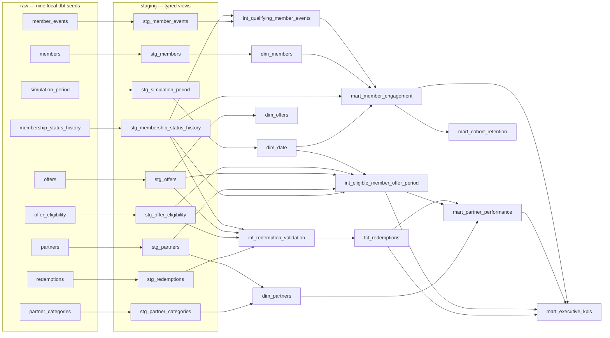

# dbt Lineage — Verified Local Model Graph

The graph below is the implemented dbt resource lineage. All seed data is deterministic synthetic CSV in an ignored local directory. No employer or customer source is connected.

## Operational verification

- `dbt parse`, `dbt compile`, `dbt docs generate` completed against dbt Core 1.12.6 and dbt-postgres 1.11.0.
- The generated `manifest.json` / `catalog.json` are local under ignored `dbt/target/`; the durable lineage view is this diagram plus model descriptions in `dbt/models/_models.yml` and grains in [`dbt-model-plan.md`](dbt-model-plan.md).
- `dbt build` ran twice successfully. Both builds had 21 models, 9 seeds, 120 data tests and 1 unit test pass; all nine final mart tables had matching row fingerprints across the two builds.
- The graph establishes transformation lineage only. It does not imply production lineage, external-system ownership, dashboard publication or commercial deployment.
